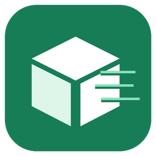

# OBox Air

[English](README.en.md)

Nieoficjalna integracja **Home Assistant** dla pomiarów jakości powietrza z automatów **Allegro One Box w Polsce**. HA pobiera dane bezpośrednio przez HTTP. Nie wymaga osobnego kontenera, MQTT, przeglądarki, konta Allegro ani klucza API.

## Możliwości

- Wyszukiwanie automatów wokół dowolnej lokalizacji w Polsce, bez wbudowanej listy miast.
- Dodawanie punktu po kodzie automatu, numerycznym ID lub linku z mapy Allegro.
- Trzy czujniki na automat: **PM2.5**, **PM10** oraz **czas pomiaru**.
- Odświeżanie co **5 minut**, kontrola aktualności danych i obsługa niedostępności.
- Konfiguracja i nazwy czujników po polsku i angielsku.

Wymagany **Home Assistant 2025.12.4 lub nowszy** i dostęp do internetu. Integracja obsługuje automaty One Box; punkty obsługi Allegro One Punkt nie są czujnikami tej integracji. Dostępność pomiarów zależy od Allegro i konkretnego automatu.

## Instalacja

### HACS

Po opublikowaniu repozytorium dodaj `https://github.com/typ14mg/OBox-Air` w **HACS → Repozytoria niestandardowe**, typ **Integracja**. Zainstaluj **OBox Air** i zrestartuj HA. Obecność repozytorium niestandardowego nie oznacza przyjęcia do głównego katalogu HACS.

### Ręcznie

1. Pobierz paczkę `obox-air-component-<wersja>.zip` z [wydań projektu](https://github.com/typ14mg/OBox-Air/releases).
2. Rozpakuj ją w katalogu konfiguracji HA. Plik manifestu powinien znaleźć się pod `/config/custom_components/allegro_onebox_air/manifest.json` wewnątrz HA Container.
3. Zrestartuj HA. Wymaganą bibliotekę `curl-cffi` HA zainstaluje automatycznie.

## Dodanie automatu

Otwórz **Ustawienia → Urządzenia i usługi → Dodaj integrację → OBox Air**. Każdy automat dodaje się osobno.

**Wyszukaj na mapie:** wybierz miejsce i odległość wyszukiwania, domyślnie 2 km. Obszar jest kwadratem sięgającym o tę odległość w czterech kierunkach. Wybierz automat z listy kodów i odległości. Adres zostanie pobrany po wyborze punktu. Jeśli Allegro zwraca grupy punktów zamiast pełnej listy, integracja poprosi o zmniejszenie obszaru.

**Podaj kod, ID lub link:** wpisz np. `AL012WE1`, numeryczne `pointId` lub pełny link do punktu z [mapy Allegro](https://allegro.pl/kampania/one/znajdz-nas). Kod automatu i `pointId` to różne identyfikatory. Kod jest wyszukiwany w całej Polsce; nie ma katalogu ograniczonego do wybranego miasta.

## Czujniki i aktualność

| Czujnik | Jednostka / typ |
|---|---|
| PM2.5 | µg/m³ |
| PM10 | µg/m³ |
| Czas pomiaru | znacznik czasu źródłowego |

Trzy czujniki jednego automatu współdzielą jedno pobranie strony. Kategoria jakości Allegro jest dostępna jako atrybut `allegro_quality`; nie jest przeliczana na AQI ani indeks GIOŚ.

Pomiar mający co najmniej **30 minut** lub czas ponad **5 minut w przyszłości** jest niedostępny. Brak wartości i błędy nie są zamieniane na zero. Rzeczywiste `0` pozostaje zerem, a wartości obu kanałów są zachowywane niezależnie. Punkt bez aktualnego pomiaru może zostać dodany, ale jego czujniki pozostaną niedostępne.

## Rozwiązywanie problemów

- **403/429 lub CAPTCHA:** Allegro odmówiło dostępu. Integracja zgłasza niedostępność; nie rozwiązuje CAPTCHA. Sprawdź ponownie później.
- **Za duży obszar:** zmniejsz odległość wyszukiwania lub podaj kod konkretnego automatu.
- **Brak pomiarów:** sprawdź ten sam punkt na mapie Allegro oraz czas źródłowy. Nie każdy punkt stale udostępnia dane.
- **Brak integracji po instalacji:** sprawdź ścieżkę katalogu, restart HA i log dotyczący instalacji zależności.

Przy zgłoszeniu błędu podaj wersję HA i integracji oraz zanonimizowany komunikat. Diagnostyka nie zawiera cookies, treści odpowiedzi ani lokalizacji wyszukiwania, ale zawiera identyfikator wybranego publicznego automatu. Usuń go, jeśli nie chcesz ujawniać, z którego punktu korzystasz. [Zgłoś błąd](https://github.com/typ14mg/OBox-Air/issues).

## Aktualizacja i usunięcie

Aktualizuj przez HACS albo zastąp cały katalog `custom_components/allegro_onebox_air` i zrestartuj HA. Nazwa publiczna zmieniła się na OBox Air, ale wewnętrzna domena pozostała taka sama, aby zachować istniejące urządzenia, encje i historię. Wpisy wersji 0.1/0.2 są migrowane automatycznie; stare ustawienia MQTT są usuwane.

Aby usunąć integrację, usuń jej wpisy w HA, odinstaluj ją w HACS lub usuń jej katalog, a następnie zrestartuj HA.

## Charakter projektu i warunki użycia

Projekt ma charakter **eksperymentalny i edukacyjny**. Demonstruje odczyt publicznych pomiarów i tworzenie czujników HA. Jest niezależny, niepowiązany z Allegro i niezatwierdzony przez Allegro.

**Korzystasz na własne ryzyko.** Kod jest udostępniany w stanie istniejącym (AS IS), bez gwarancji, w zakresie [licencji MIT](LICENSE) i dopuszczalnym przez prawo. Nie gwarantuje poprawności pomiarów, dostępności danych ani ciągłości działania.

Licencja MIT dotyczy kodu, **nie stanowi zgody Allegro na pobieranie lub wykorzystywanie danych**. Przed uruchomieniem oceń zgodność własnego sposobu użycia z prawem, [regulaminem Allegro](https://allegro.pl/regulamin) i prawami do danych; uzyskaj zgodę, jeśli jest wymagana. Edukacyjny charakter i zapis o własnym ryzyku nie wyłączają przepisów, praw osób trzecich ani odpowiedzialności, której nie można wyłączyć.

## Rozwój

[Zmiany](CHANGELOG.md) · [Współtworzenie](CONTRIBUTING.md) · [Testy](TESTING.md) · [Publikacja](PUBLISHING.md) · [Bezpieczeństwo](SECURITY.md)

Układ projektu jest inspirowany [InPost Air](https://github.com/CyberDeer/InPost-Air); kod napisano niezależnie. Źródłem danych jest Allegro. Techniczny odczyt korzysta z nieudokumentowanego endpointu mapy oraz JSON-u osadzonego w stronie punktu; zmiany po stronie Allegro mogą wymagać aktualizacji integracji.
